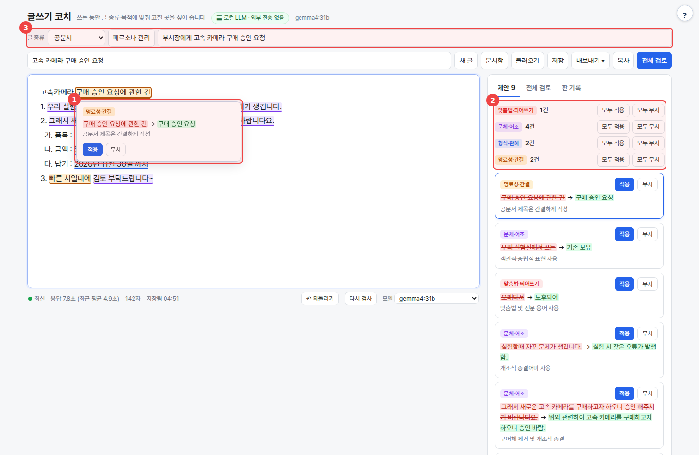
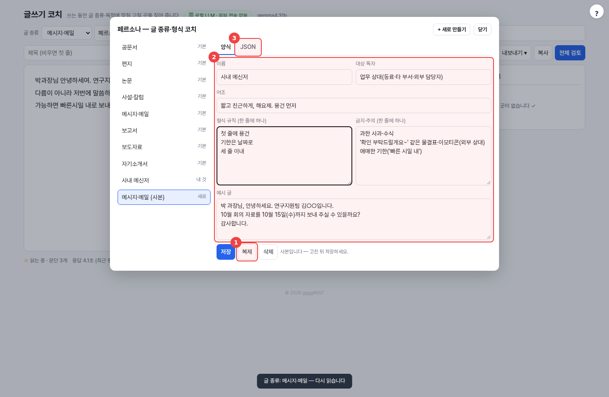
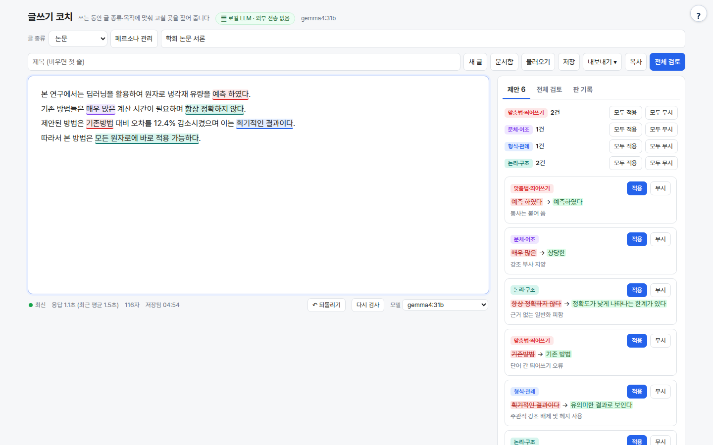

# coach-local — 쓰는 동안 고칠 곳을 짚어 주는 글쓰기 코치

공문서·편지·논문·사설·메일처럼 **글 종류(페르소나)와 목적**을 정해 두고 글을 쓰면, 잠깐 멈출 때마다 바뀐 문단만 로컬 LLM이 다시 읽고 고칠 곳을 밑줄과 카드로 제안하는 웹 UI / CLI입니다.



## 무엇을 하나

- **준실시간 제안**: 타이핑을 멈추고 약 1.2초가 지나면, 바뀐 문단만 LLM에 보냅니다. 지금 쓰는 문단은 따로 먼저 보내고, 나머지 문단은 2개 요청으로 나눠 동시에 보냅니다. 그사이 지워지거나 바뀐 문단의 요청은 취소합니다(브라우저 요청을 끊고, 서버도 LLM 생성을 멈춤).
- **자리가 정확한 제안**: LLM이 돌려준 "원문 조각"이 그 문단에 글자 그대로 있을 때만 제안을 남기고, 찾지 못한 제안은 버립니다. 자리표시(○○, XX)를 넣거나 글에 없는 내용을 지어낸 제안도 버립니다.
- **6가지 분류**: 맞춤법·띄어쓰기 / 문체·어조 / 형식·관례 / 명료성·간결 / 논리·구조 / 사실 확인 필요. 제안마다 원문 → 제안, 짧은 이유를 보여 줍니다. 하나씩 **적용·무시**할 수도 있고, 분류별로 **모두 적용·모두 무시**할 수도 있습니다. 되돌리기는 **Ctrl+Z**를 그대로 쓰면 됩니다.
- **페르소나 = JSON 하나**: 이름·대상 독자·어조·형식 규칙·금지/주의·예시. 공문서·편지·논문·사설·칼럼·메시지·메일·보고서·보도자료·자기소개서 8개가 기본으로 들어 있습니다. 기본 페르소나를 복제해 양식이나 JSON으로 고치면 내 페르소나가 됩니다.
- **전체 검토**: 맞춤법은 빼고, 구조·흐름·빠진 요소(공문의 '끝.'·붙임, 메일의 기한 등)와 목적에 맞는지를 짚습니다.
- **문서함·판 기록**: 쓰는 글은 3초 뒤 자동 저장됩니다. **저장**을 누르거나 10분이 지나면 판이 하나씩 남습니다(최대 30개).
- **불러오기·내보내기**: txt·md·docx를 불러오고, [kordoc-local](https://github.com/gggg8657/kordoc-local)이 옆 폴더에 있으면 hwp·hwpx·pdf도 불러옵니다. 내보내기는 .txt·.md·.docx와 복사를 지원합니다.
- 외부 의존성 0 — Python 3.9+ 표준 라이브러리만 씁니다(.docx도 stdlib로 처리).

## 사용 방법

포털을 거치면 `http://<포털>:8700/t/coach-local/`, 단독으로 실행하면 `http://localhost:8798` 화면에서 씁니다.

1. **글 종류와 목적을 정한다** — 맨 위 **글 종류**에서 페르소나를 고르고, **목적 한 줄**을 적습니다(예: "부서장에게 고속 카메라 구매 승인 요청"). 제안이 이 둘에 맞춰집니다. (그림 ③)
2. **쓰다가 멈춘다** — 편집기에 글을 씁니다. 1초쯤 멈추면 바뀐 문단에 색 밑줄이 생기고(색은 분류), 오른쪽에 제안 카드가 쌓입니다.
3. **적용하거나 무시한다** — 밑줄을 누르면 그 자리에 제안 상자가 뜹니다(그림 ①). 카드에서 하나씩 처리해도 되고, 분류별 **모두 적용**을 눌러도 됩니다(그림 ②). 잘못 바꿨으면 **↶ 되돌리기** 또는 Ctrl+Z를 누릅니다.
4. **전체 검토 후 내보낸다** — **전체 검토**로 구조와 빠진 요소를 확인하고, **내보내기**(.txt·.md·.docx)나 **복사**로 가져갑니다.

부서 양식이 따로 있으면 **페르소나 관리**에서 가까운 기본 페르소나를 **복제**한 뒤 규칙을 고쳐 저장하세요. JSON 탭에서 통째로 붙여 넣어도 됩니다.

<details><summary>페르소나 관리 화면 — ① 복제 ② 양식 편집 ③ JSON 편집</summary>



</details>

## 예시

아래는 `gemma4:31b`(GPU Ollama)로 실제 실행한 결과입니다.

**논문** 페르소나, 목적 "학회 논문 서론". 한 문단을 쓰고 멈출 때마다 측정했습니다. 마지막 키 입력부터 제안이 뜰 때까지 2.3~3.3초, 중앙값 2.6초가 걸렸습니다. 여기에는 1.2초 대기가 들어 있고, LLM 응답만 보면 1.1~2초입니다.



입력:

```text
본 연구에서는 딥러닝을 활용하여 원자로 냉각재 유량을 예측 하였다.
기존 방법들은 매우 많은 계산 시간이 필요하며 항상 정확하지 않다.
제안된 방법은 기존방법 대비 오차를 12.4% 감소시켰으며 이는 획기적인 결과이다.
따라서 본 방법은 모든 원자로에 바로 적용 가능하다.
```

제안(6건):

| 분류 | 원문 → 제안 | 이유 |
|---|---|---|
| 맞춤법·띄어쓰기 | 예측 하였다 → 예측하였다 | 동사는 붙여 씀 |
| 문체·어조 | 매우 많은 → 상당한 | 강조 부사 지양 |
| 논리·구조 | 항상 정확하지 않다 → 정확도가 낮게 나타나는 한계가 있다 | 근거 없는 일반화 피함 |
| 맞춤법·띄어쓰기 | 기존방법 → 기존 방법 | 단어 간 띄어쓰기 오류 |
| 형식·관례 | 획기적인 결과이다 → 유의미한 결과로 보인다 | 주관적 강조 배제 및 헤지 사용 |
| 논리·구조 | 모든 원자로에 바로 적용 가능하다 → 다양한 원자로에 적용될 가능성이 있다 | 근거 없는 일반화 및 단정 피함 |

**공문서**로 일부러 엉성하게 쓴 구매 승인 요청(위 그림)에서는 7줄을 쉬지 않고 한꺼번에 입력했습니다. 마지막 입력 후 첫 제안까지 약 6.6초, 7줄 제안이 다 뜨기까지 약 9초가 걸렸습니다. 페르소나를 바꾼 직후의 첫 요청은 프롬프트를 새로 읽느라 더 느립니다(이번 실행 5.2초, 이후 한 문단 요청은 1.5~3초). 제안에는 "일천이백만원 → 금 12,000,000원(금 일천이백만 원)", "오래되서 → 노후되어", 구어체 문장을 개조식 "~바람"으로 바꾸기 등이 있었습니다. **전체 검토**(약 7초)는 '관련' 근거 항목, 본문 끝의 '끝.'과 붙임 표기, 날짜 표기(2026. 11. 30.)가 빠졌다고 짚었습니다.

제안은 LLM의 의견입니다. 틀린 맞춤법을 놓치거나, 고치지 않아도 될 곳을 고치라고 할 수 있습니다. 숫자와 고유명사는 직접 확인하세요.

## 실행

```bash
bash setup.sh                     # Python 확인 → LLM 탐색 → selftest → http://localhost:8798
bash setup.sh stop
python3 app.py                    # 수동
python3 app.py --cli paper 초안.txt   # 문단별 제안을 터미널에 (페르소나 id: gongmun letter paper editorial message report press intro)
python3 selftest.py               # LLM 없이(가짜 LLM) 자리 확인·문서·사용자 분리·docx 검증
```

| 환경변수 | 기본 | 설명 |
|---|---|---|
| `LLM_API` | `ollama` | `ollama` 또는 `openai` |
| `LLM_BASE_URL` | `http://localhost:11434` / `http://localhost:8000/v1` | 서버 주소 |
| `LLM_MODEL` | `qwen3:8b` | 기본 모델(화면에서 바꿀 수 있음) |
| `LLM_API_KEY` | (없음) | OpenAI 호환 서버 키 |
| `NUM_CTX` | `32768` | Ollama 컨텍스트. 다른 도구와 같은 값이어야 모델을 다시 올리지 않음 |
| `PORT` | `8798` | |
| `BIND` | (모든 인터페이스) | 포털은 `127.0.0.1`을 넘김 — 포털을 거쳐서만 접근 |
| `WORKSPACE` | `./_workspace` | 문서·내 페르소나 저장 위치(포털이 `_data/coach-local`로 지정) |
| `KORDOC_CLI` | `../kordoc-local/node_modules/kordoc/dist/cli.js` | hwp·hwpx·pdf 불러오기용. 없으면 txt·md·docx만 |

[agent-page-portal](https://github.com/gggg8657/agent-page-portal)에서 띄우면 `PORT`·`WORKSPACE`·`BIND`를 포털이 정하고, LLM 설정은 포털 프로세스의 환경변수를 물려받습니다. 현재 운영 기본값은 GPU Ollama의 `gemma4:31b`이고, 단독 실행 시 코드 기본값은 `qwen3:8b`입니다.

**사용자별 저장**: 문서와 내 페르소나는 포털 접속자(`X-Agent-User`)마다 `WORKSPACE/u/<사용자>/` 아래에 따로 저장됩니다. 서버 주인(owner)과 단독 실행은 `WORKSPACE` 바로 아래를 씁니다. 기본 페르소나는 모두가 함께 씁니다.

## 페르소나 형식

```json
{"name": "사내 메신저", "audience": "같은 팀 동료", "tone": "짧고 친근하게, 해요체",
 "rules": ["첫 줄에 용건", "기한은 날짜로"], "avoid": ["물결표·이모티콘 남발"], "example": "…"}
```

기본 페르소나는 `personas.json`에 있습니다. 여기에 항목을 추가하면 모두에게 보이고, 화면에서 만든 것은 그 사용자에게만 보입니다.

## 출처·감사 (Credits)

- 파이썬 표준 라이브러리만 씁니다. hwp·hwpx·pdf 불러오기는 같은 저작자의 [kordoc-local](https://github.com/gggg8657/kordoc-local)에 설치된 [kordoc](https://github.com/chrisryugj/kordoc)(MIT) CLI를 실행합니다. 이 저장소에는 동봉하지 않습니다.
- **LLM 실행** — OpenAI 호환 API로 호출합니다(모델 가중치는 동봉하지 않음). 기본 배포는 [Ollama](https://github.com/ollama/ollama)(MIT) 위의 Google [Gemma](https://ai.google.dev/gemma) `gemma4:31b`입니다. 모델 이용 조건은 Gemma 배포처를 참고하세요.
- 이 도구는 [agent-page-portal](https://github.com/gggg8657/agent-page-portal)에 연결해 쓰도록 만들었습니다(단독 실행도 됨).

저작권 표기와 전체 목록은 `NOTICE`를 보세요.

## 라이선스

[MIT License](LICENSE) © 2026 DongJu Kim (gggg8657).
